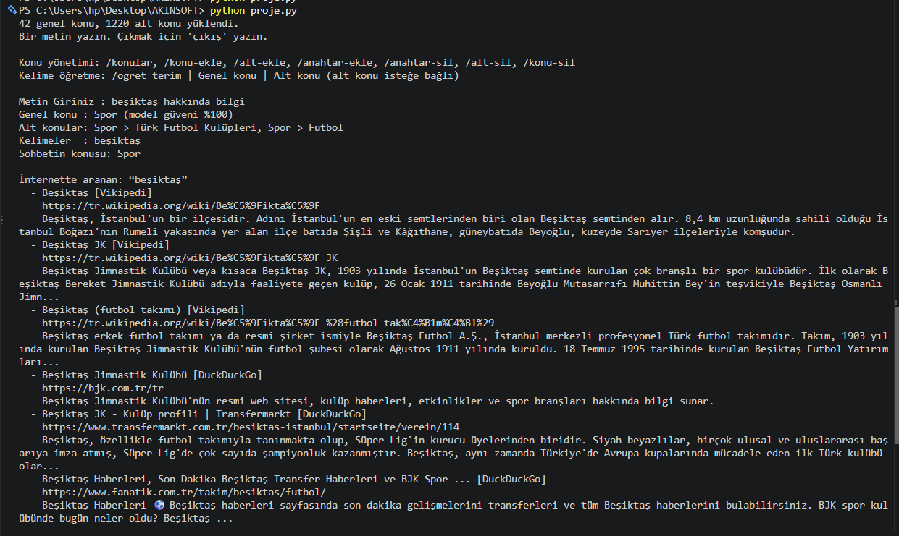
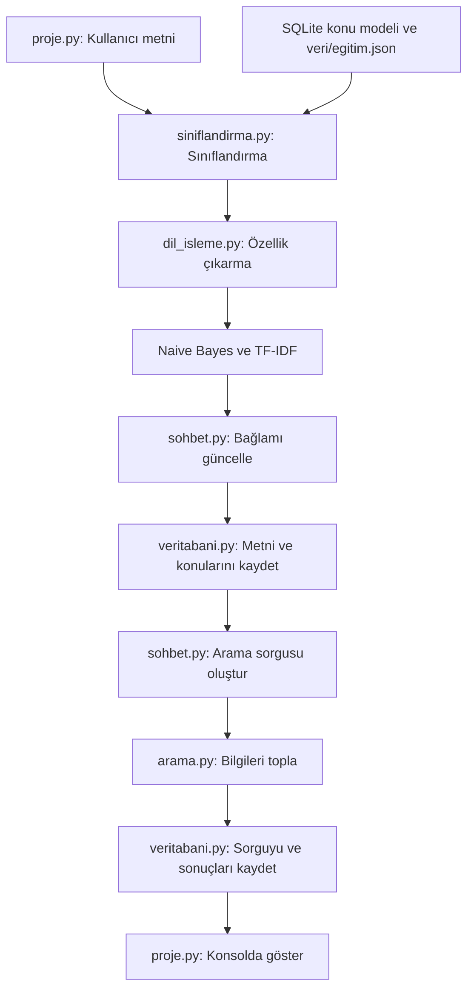

# Metin Sınıflandırma ve Bilgi Arama

Projenin başlangıç konu ağacında 42 ana konu vardır. Konular ilk açılışta `veri/konular.txt` dosyasından SQLite'a aktarılır; daha sonra uygulama konu ve anahtar kelimeleri `kayitlar.db` içindeki ilişkisel modelden yükler. Çalışırken yapılan ekleme ve silmeler anında kaydedilir.

## Sınıflandırma Yaklaşımı

Projede önceden eğitilmiş veya dışarıdan indirilmiş bir dil modeli kullanılmıyor. Sınıflandırma, proje içinde uygulanmış Multinomial Naive Bayes ile yapılır; alt konu eşleştirmesinde TF-IDF ve kosinüs benzerliği kullanılır. Bu yöntemler, Türkçe metin işleme bileşeninin çıkardığı özellikler ve SQLite'ta saklanan konu anahtarlarıyla çalışır.

## Ekran Görüntüsü



## Ele Alınan Konular

Başlangıç konuları [veri/konular.txt](veri/konular.txt) dosyasında tanımlıdır. Her ana konu, ilgili alt konuları ve anahtar kelimeleri içerir. TXT dosyası yalnızca boş bir veritabanının ilk kurulumu için kullanılır.

- Bilim
- Teknoloji
- Sağlık
- Psikoloji
- Spor
- Ekonomi
- İş ve Kariyer
- Eğitim
- Edebiyat ve Kitaplar
- Sanat
- Müzik
- Sinema ve Televizyon
- Oyunlar
- Yemek ve Mutfak
- Seyahat ve Turizm
- Tarih
- Coğrafya
- Çevre
- Enerji
- Doğal Afetler
- Hayvanlar
- Tarım ve Bahçe
- Siyaset
- Hukuk
- Otomotiv ve Ulaşım
- Ev ve Yaşam
- Aile ve İlişkiler
- Moda ve Güzellik
- Din ve İnanç
- Felsefe
- Toplum ve Kültür
- Medya ve İletişim
- Askeri ve Savunma
- Hobiler
- Mimarlık ve İnşaat
- Hava Durumu
- Asayiş ve Suç
- Eğlence ve Etkinlikler
- Resmi İşler ve Bürokrasi
- Alışveriş ve Tüketim
- Diller ve Dilbilim
- Mühendislik

## Çalıştırma

Proje dizininde aşağıdaki komutu çalıştırın:

```bash
python proje.py
```


Proje `python proje.py` komutuyla başlatıldığında, proje dizininde `kayitlar.db` adlı SQLite veritabanı dosyası yoksa otomatik olarak oluşturulur. İlk açılışta konu ağacı `veri/konular.txt` dosyasından SQLite konu tablolarına aktarılır. Sonraki açılışlarda konular doğrudan veritabanından yüklenir. Bu veritabanında kullanıcı metinleri, sınıflandırma sonuçları, oturum bilgileri, arama sorguları, arama sonuçları ve dinamik konu ağacı saklanır.

## Konu Ağacını Yönetme

Konu değişiklikleri veritabanına kaydedilir ve sınıflandırıcı hemen yenilenir. Konuları listelemek ve yönetmek için uygulama çalışırken şu komutları kullanın:

```text
/konular
/konu-ekle Yeni konu | anahtar1, anahtar2
/alt-ekle Genel konu | Alt konu | anahtar1, anahtar2
/anahtar-ekle Genel konu | Alt konu (boş bırakılabilir) | anahtar1, anahtar2
/anahtar-sil Genel konu | Alt konu (boş bırakılabilir) | anahtar1, anahtar2
/alt-sil Genel konu | Alt konu
/konu-sil Genel konu
```

Örneğin `gol beklentisi` anahtarını Spor konusunun Futbol alt konusuna eklemek için:

```text
/anahtar-ekle Spor | Futbol | gol beklentisi
```

## İşleyiş

Kullanıcı metni sınıflandırılır, sohbet bağlamı güncellenir ve ilgili bilgiler aranır. Metin, konular ve arama sonuçları veritabanına kaydedilir; sonuçlar konsolda gösterilir.


